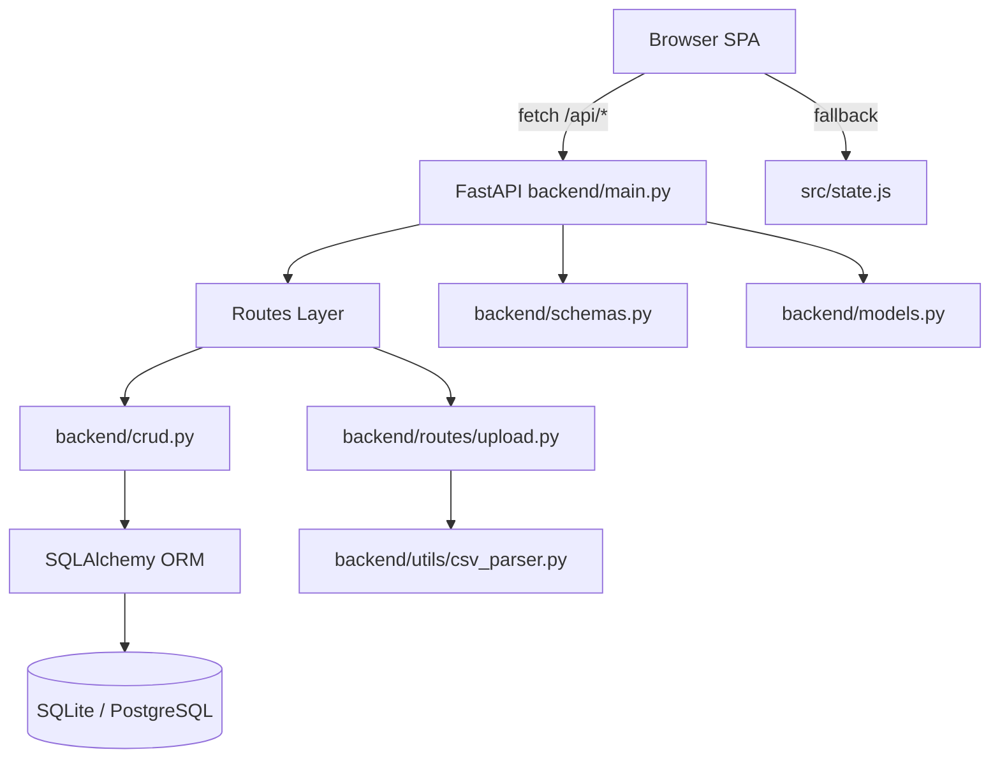

# Design Document: FastAPI Backend

## Overview

This document describes the technical design for replacing the localStorage-backed stub layer in the Smart Inventory Management System SPA with a real FastAPI + SQLAlchemy backend.

The backend exposes a REST API at `/api/*` for full CRUD on inventory items and bulk CSV upload. The frontend `src/api.js` module is updated to call these endpoints via `fetch()`, with graceful fallback to local state when the backend is unreachable.

The existing frontend modules (`state.js`, `ui.js`, `charts.js`, `main.js`) are unchanged. Only `src/api.js` is modified.

---

## Architecture

### System Overview



### Backend File Layout

```
backend/
├── main.py               # FastAPI app init, CORS, router registration
├── database.py           # SQLAlchemy engine, SessionLocal, get_db dependency
├── models.py             # SQLAlchemy ORM model: InventoryItem
├── schemas.py            # Pydantic v2 schemas: InventoryItemCreate, InventoryItemUpdate, InventoryItemOut
├── crud.py               # All DB query functions (thin route handlers delegate here)
├── routes/
│   ├── __init__.py
│   ├── inventory.py      # GET/POST/PUT/DELETE /api/inventory
│   └── upload.py         # POST /api/inventory/upload
└── utils/
    ├── __init__.py
    └── csv_parser.py     # Standalone CSV parse/serialize utility, no FastAPI imports
```

### Frontend Change

Only `src/api.js` is modified. All other frontend modules are untouched.

---

## Components and Interfaces

### `backend/main.py`

```python
app = FastAPI(title="Inventory Management API")

app.add_middleware(
    CORSMiddleware,
    allow_origins=["http://localhost:5173", "http://127.0.0.1:5500", "*"],
    allow_methods=["*"],
    allow_headers=["*"],
)

app.include_router(inventory_router, prefix="/api")
app.include_router(upload_router, prefix="/api")
```

### `backend/database.py`

```python
DATABASE_URL = os.getenv("DATABASE_URL", "sqlite:///./inventory.db")

engine = create_engine(DATABASE_URL, connect_args={"check_same_thread": False})
SessionLocal = sessionmaker(autocommit=False, autoflush=False, bind=engine)

def get_db() -> Generator[Session, None, None]:
    db = SessionLocal()
    try:
        yield db
    finally:
        db.close()
```

### `backend/routes/inventory.py`

| Method | Path | Handler | Description |
|---|---|---|---|
| `GET` | `/api/inventory` | `list_inventory` | Paginated list with optional `category`, `sort_by`, `sort_order` |
| `POST` | `/api/inventory` | `create_inventory_item` | Create item, returns 201 |
| `PUT` | `/api/inventory/{id}` | `update_inventory_item` | Partial update, returns updated item |
| `DELETE` | `/api/inventory/{id}` | `delete_inventory_item` | Delete item, returns 204 |

All handlers use `db: Session = Depends(get_db)` and delegate to `crud.py`.

### `backend/routes/upload.py`

| Method | Path | Handler | Description |
|---|---|---|---|
| `POST` | `/api/inventory/upload` | `upload_csv` | Multipart CSV upload, returns `UploadSummary` |

### `backend/crud.py`

| Function | Signature | Description |
|---|---|---|
| `get_items` | `(db, limit, offset, category, sort_by, sort_order) -> list[InventoryItem]` | Paginated query with optional filter and sort |
| `get_item` | `(db, item_id) -> InventoryItem \| None` | Fetch single item by id |
| `create_item` | `(db, item: InventoryItemCreate) -> InventoryItem` | Insert new item |
| `update_item` | `(db, item_id, patch: InventoryItemUpdate) -> InventoryItem \| None` | Partial update, sets `last_updated` to UTC now |
| `delete_item` | `(db, item_id) -> bool` | Delete item, returns False if not found |
| `upsert_item_by_sku` | `(db, item: InventoryItemCreate) -> tuple[InventoryItem, bool]` | Insert or update by SKU; returns (item, created) |

### `backend/utils/csv_parser.py`

```python
REQUIRED_COLUMNS = {"sku", "name", "category", "quantity", "mrp"}

def parse_csv(content: str) -> tuple[list[dict], list[str]]:
    """
    Parse CSV text into a list of row dicts and a list of missing column names.
    Returns (rows, missing_columns). If missing_columns is non-empty, rows is [].
    Converts mrp (Rupees float) -> mrp_paise (int) by round(mrp * 100).
    Skips rows where quantity < 0 or mrp_paise <= 0.
    Returns (valid_rows, skipped_rows) as second element when called from upload handler.
    """

def serialize_items(items: list[dict]) -> str:
    """
    Serialize a list of InventoryItem dicts to a canonical CSV string.
    Columns: sku, name, category, quantity, mrp_paise, abc_xyz_class, last_updated
    """
```

The `csv_parser.py` module imports only from the Python standard library (`csv`, `io`, `datetime`). No FastAPI or SQLAlchemy imports.

### `src/api.js` (updated)

```js
const API_BASE_URL = "http://localhost:8000";

async function apiFetch(path, options = {}) { ... }  // shared fetch wrapper with fallback

export async function fetchInventory(params = {}) { ... }   // GET /api/inventory
export async function createItem(item) { ... }              // POST /api/inventory
export async function updateItem(id, patch) { ... }         // PUT /api/inventory/{id}
export async function deleteItem(id) { ... }                // DELETE /api/inventory/{id}
export async function uploadCSV(file) { ... }               // POST /api/inventory/upload
```

The `apiFetch` wrapper catches `TypeError` (network error) and non-2xx responses, logs a warning, and invokes the corresponding `state.js` fallback.

---

## Data Models

### SQLAlchemy Model (`backend/models.py`)

```python
class InventoryItem(Base):
    __tablename__ = "inventory_items"

    id           = Column(Integer, primary_key=True, autoincrement=True)
    sku          = Column(String, unique=True, index=True, nullable=False)
    name         = Column(String, nullable=False)
    category     = Column(String, index=True, nullable=True)
    quantity     = Column(Integer, nullable=False)
    mrp_paise    = Column(Integer, nullable=False)
    last_updated = Column(DateTime, default=func.now(), onupdate=func.now(), nullable=False)
    abc_xyz_class = Column(String, nullable=True)

    __table_args__ = (
        CheckConstraint("quantity >= 0", name="ck_quantity_non_negative"),
    )
```

### Pydantic Schemas (`backend/schemas.py`)

```python
class InventoryItemCreate(BaseModel):
    sku: str = Field(..., min_length=1)
    name: str = Field(..., min_length=1)
    category: str | None = None
    quantity: int = Field(..., ge=0)
    mrp_paise: int = Field(..., gt=0)
    abc_xyz_class: str | None = None

class InventoryItemUpdate(BaseModel):
    name: str | None = Field(default=None, min_length=1)
    category: str | None = None
    quantity: int | None = Field(default=None, ge=0)
    mrp_paise: int | None = Field(default=None, gt=0)
    abc_xyz_class: str | None = None

class InventoryItemOut(InventoryItemCreate):
    id: int
    last_updated: datetime

    model_config = ConfigDict(from_attributes=True)

class UploadSummary(BaseModel):
    imported: int
    skipped: int
    errors: list[str]
```

### Frontend InventoryItem (unchanged)

The frontend continues to use the existing `InventoryItem` shape from `state.js`. The `api.js` layer maps between the backend schema (snake_case, `mrp_paise`) and the frontend shape (`mrp` in paise, `available_qty`, etc.) in the fetch wrapper.

### Field Mapping: Backend ↔ Frontend

| Backend field | Frontend field | Notes |
|---|---|---|
| `sku` | *(new field)* | Added to frontend item shape |
| `name` | `name` | Direct |
| `category` | `category` | Direct |
| `quantity` | `available_qty` | Renamed |
| `mrp_paise` | `mrp` | Same unit (paise), different name |
| `last_updated` | `last_updated` | ISO string on frontend |
| `abc_xyz_class` | *(new field)* | Added to frontend item shape |

---

## Correctness Properties

*A property is a characteristic or behavior that should hold true across all valid executions of a system — essentially, a formal statement about what the system should do. Properties serve as the bridge between human-readable specifications and machine-verifiable correctness guarantees.*

### Property 1: SKU uniqueness is enforced

*For any* two InventoryItem records, if both have the same `sku` value, the database SHALL reject the second insertion with an integrity error.

**Validates: Requirements 2.2**

---

### Property 2: Quantity non-negative constraint

*For any* InventoryItem payload where `quantity` is less than 0, the API SHALL return HTTP 422 and the item SHALL NOT be persisted to the database.

**Validates: Requirements 2.3, 5.1**

---

### Property 3: Pagination respects limit

*For any* `limit` value L (1 ≤ L ≤ 500) and any database state, a GET to `/api/inventory?limit=L` SHALL return a list of at most L items.

**Validates: Requirements 3.1**

---

### Property 4: Category filter returns only matching items

*For any* category string C and any database state, a GET to `/api/inventory?category=C` SHALL return only items whose `category` field equals C.

**Validates: Requirements 3.2**

---

### Property 5: Sort order is correct

*For any* valid sortable column name and sort direction (`asc` or `desc`), a GET to `/api/inventory?sort_by=<col>&sort_order=<dir>` SHALL return items in the specified order according to that column's values.

**Validates: Requirements 3.3**

---

### Property 6: Create-then-fetch round trip

*For any* valid `InventoryItemCreate` payload, POSTing it to `/api/inventory` and then GETting `/api/inventory/{id}` using the returned `id` SHALL return an item whose fields match the original payload.

**Validates: Requirements 3.4**

---

### Property 7: Update sets last_updated to current UTC time

*For any* existing item and any valid `InventoryItemUpdate` patch, a PUT to `/api/inventory/{id}` SHALL return an item whose `last_updated` is greater than or equal to the `last_updated` value before the update.

**Validates: Requirements 3.5**

---

### Property 8: Delete removes item

*For any* existing item with id I, a DELETE to `/api/inventory/I` SHALL return 204, and a subsequent GET to `/api/inventory/I` SHALL return 404.

**Validates: Requirements 3.6**

---

### Property 9: Non-existent id returns 404

*For any* id I that does not exist in the database, GET `/api/inventory/I`, PUT `/api/inventory/I`, and DELETE `/api/inventory/I` SHALL each return HTTP 404.

**Validates: Requirements 3.7**

---

### Property 10: CSV upload returns correct summary counts

*For any* CSV file with N valid rows and M invalid rows (negative quantity or zero MRP), a POST to `/api/inventory/upload` SHALL return a summary where `imported + skipped == N + M` and `skipped == M`.

**Validates: Requirements 4.1, 4.7**

---

### Property 11: Missing CSV columns returns 422

*For any* CSV file that is missing at least one of the required columns (`sku`, `name`, `category`, `quantity`, `mrp`), a POST to `/api/inventory/upload` SHALL return HTTP 422 with a message listing the missing column names.

**Validates: Requirements 4.3**

---

### Property 12: MRP paise conversion is correct

*For any* `mrp` value (in Rupees, as a decimal string in the CSV), the parsed `mrp_paise` value SHALL equal `round(float(mrp) * 100)`.

**Validates: Requirements 4.4**

---

### Property 13: CSV upsert behavior

*For any* CSV upload where some rows have SKUs already in the database and some have new SKUs, after the upload: existing SKU records SHALL be updated with the new values, new SKU records SHALL be inserted, and the total item count SHALL equal the count before upload plus the number of new SKUs.

**Validates: Requirements 4.5, 4.6**

---

### Property 14: CSV round-trip

*For any* non-empty list of valid InventoryItem records, serializing to CSV with `serialize_items` and then parsing with `parse_csv` and serializing again SHALL produce an identical CSV string.

**Validates: Requirements 4.9**

---

### Property 15: Invalid payloads are rejected with 422

*For any* POST or PUT payload where `quantity < 0`, `mrp_paise <= 0`, `name` is empty/absent, or `sku` is empty/absent, the API SHALL return HTTP 422 with a `detail` array describing the validation error.

**Validates: Requirements 5.1, 5.2, 5.3, 5.4, 5.5**

---

### Property 16: API client constructs correct fetch calls

*For any* set of parameters passed to `fetchInventory`, `createItem`, `updateItem`, `deleteItem`, or `uploadCSV`, the underlying `fetch()` call SHALL use the correct HTTP method, URL (including `API_BASE_URL` prefix and path parameters), and request body/headers.

**Validates: Requirements 6.1, 6.2, 6.3, 6.4, 6.5**

---

### Property 17: Frontend falls back on network error

*For any* API function call where `fetch()` throws a `TypeError` (network unreachable) or returns a non-2xx response, the function SHALL invoke the corresponding `state.js` fallback and log a warning to the console.

**Validates: Requirements 6.6**

---

### Property 18: Database session is always closed

*For any* request handled by the API, the SQLAlchemy session SHALL be closed (via the `finally` block in `get_db`) regardless of whether the handler succeeds or raises an exception.

**Validates: Requirements 7.4**

---

## Error Handling

### HTTP Error Responses

| Condition | Status | Body |
|---|---|---|
| Item not found by id | 404 | `{"detail": "Item with id {id} not found"}` |
| Pydantic validation failure | 422 | `{"detail": [{"loc": [...], "msg": "...", "type": "..."}]}` |
| Missing CSV columns | 422 | `{"detail": "Missing required columns: {cols}"}` |
| Duplicate SKU on POST | 409 | `{"detail": "Item with sku '{sku}' already exists"}` |
| Internal server error | 500 | `{"detail": "Internal server error"}` |

### Backend Error Handling

- Route handlers wrap `crud.py` calls in `try/except` for `IntegrityError` (duplicate SKU) and re-raise as `HTTPException(409)`.
- `get_db` uses `try/finally` to guarantee session closure.
- CSV parser returns `([], missing_cols)` on missing columns; the upload route converts this to a 422 response.
- Invalid CSV rows are collected into the `errors` list in `UploadSummary` rather than aborting the entire upload.

### Frontend Error Handling

```js
async function apiFetch(path, options = {}) {
  try {
    const res = await fetch(`${API_BASE_URL}${path}`, options);
    if (!res.ok) throw new Error(`HTTP ${res.status}`);
    return await res.json();
  } catch (err) {
    console.warn(`[api] Backend unreachable, falling back to local state: ${err.message}`);
    return null;  // callers check for null and invoke state.js fallback
  }
}
```

Each exported function checks the return value of `apiFetch` and falls back to the corresponding `state.js` function when `null` is returned.

---

## Testing Strategy

### Dual Testing Approach

Both unit tests and property-based tests are required and complementary:

- **Unit tests**: specific examples, integration points, edge cases, error conditions
- **Property tests**: universal invariants across many generated inputs

### Property-Based Testing Library

**Backend (Python)**: use [Hypothesis](https://hypothesis.readthedocs.io/) with `pytest`. Integrates with FastAPI's `TestClient`.

**Frontend (JavaScript)**: use [fast-check](https://github.com/dubzzz/fast-check) with Vitest.

Each property test must run a minimum of **100 iterations**.

Each property test must include a comment tag:
```
# Feature: fastapi-backend, Property N: <property text>
```

### Property Tests

Each correctness property maps to exactly one property-based test:

| Property | Test description | Arbitraries |
|---|---|---|
| P1: SKU uniqueness | Generate two items with same SKU; assert second insert raises IntegrityError | `st.text(min_size=1)` for SKU |
| P2: Quantity non-negative | Generate quantity < 0; POST to API; assert 422 | `st.integers(max_value=-1)` |
| P3: Pagination limit | Generate limit 1–500 and N items; GET with limit; assert len(result) <= limit | `st.integers(1, 500)` |
| P4: Category filter | Generate items with mixed categories; GET with category; assert all match | `st.lists(st.builds(...))` |
| P5: Sort order | Generate items; GET with sort_by and sort_order; assert list is sorted | `st.sampled_from(valid_cols)` |
| P6: Create-fetch round trip | Generate valid item; POST; GET by id; assert fields match | `st.builds(InventoryItemCreate, ...)` |
| P7: Update sets last_updated | Generate item and patch; PUT; assert last_updated >= before | `st.builds(InventoryItemUpdate, ...)` |
| P8: Delete removes item | Generate item; POST; DELETE; GET; assert 404 | `st.builds(InventoryItemCreate, ...)` |
| P9: Non-existent id returns 404 | Generate id not in DB; GET/PUT/DELETE; assert 404 | `st.integers(min_value=999999)` |
| P10: CSV upload summary counts | Generate CSV with N valid + M invalid rows; upload; assert counts | `st.lists(...)` |
| P11: Missing CSV columns returns 422 | Generate CSV missing 1+ required columns; upload; assert 422 | `st.sets(st.sampled_from(REQUIRED_COLUMNS))` |
| P12: MRP paise conversion | Generate mrp float; parse CSV row; assert mrp_paise == round(mrp * 100) | `st.floats(min_value=0.01, max_value=100000)` |
| P13: CSV upsert behavior | Generate existing + new SKUs in CSV; upload; assert counts | `st.lists(...)` |
| P14: CSV round-trip | Generate list of valid items; serialize; parse; serialize; assert equal | `st.lists(st.builds(...), min_size=1)` |
| P15: Invalid payloads rejected | Generate payloads with each invalid field; POST; assert 422 | `st.one_of(...)` |
| P16: API client fetch calls | Mock fetch; call each api.js function with random params; assert fetch called with correct args | `fc.record(...)` |
| P17: Frontend fallback | Mock fetch to throw/return non-2xx; call api.js functions; assert state.js fallback invoked | `fc.constantFrom(...)` |
| P18: Session always closed | Generate requests that succeed and fail; assert session.close() called | `st.booleans()` for success/fail |

### Unit Tests

Unit tests focus on:

- **Startup**: `GET /` or `GET /api/inventory` on a fresh DB returns 200 and empty list
- **CORS headers**: response to a cross-origin request includes `Access-Control-Allow-Origin`
- **`get_db` generator**: calling `next(get_db())` yields a Session; calling `close()` on the generator closes the session
- **CSV parser — happy path**: parse a well-formed CSV with all required columns; assert correct row count and mrp_paise values
- **CSV parser — missing columns**: parse a CSV missing `sku`; assert missing columns list is `["sku"]`
- **CSV parser — invalid rows**: parse a CSV with one row having `quantity=-1`; assert it appears in skipped list
- **`serialize_items` output**: call with a known list; assert header row and data rows are correct
- **`API_BASE_URL` default**: import `api.js`; assert `API_BASE_URL === "http://localhost:8000"`
- **`uploadCSV` uses FormData**: mock fetch; call `uploadCSV(file)`; assert fetch body is a `FormData` instance
- **404 on missing item**: DELETE a non-existent id; assert 404 with descriptive message
- **409 on duplicate SKU**: POST same SKU twice; assert second returns 409
