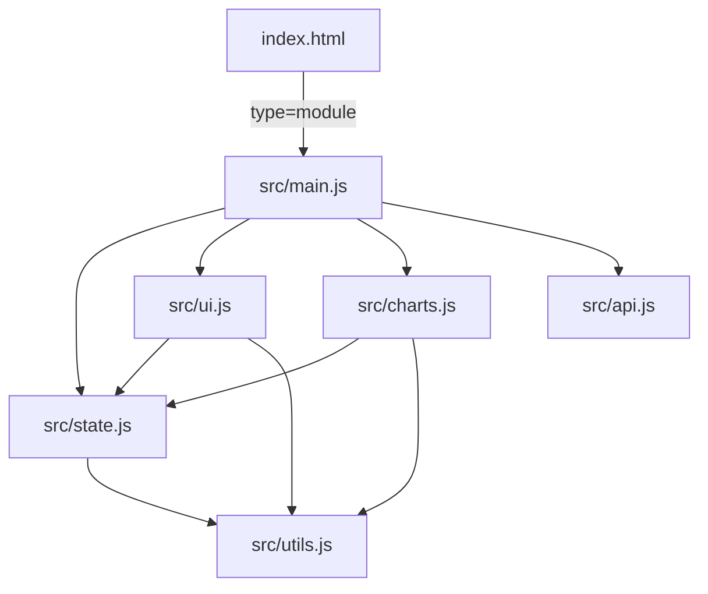

# Design Document: Inventory Modularization

## Overview

This document describes the technical design for refactoring the Retail Shop Inventory Management SPA from a monolithic `app.js` (1,388 lines) and duplicated `style.css` (2,602 lines) into a maintainable, modular architecture.

The refactoring is purely structural — no new features are added. The runtime behavior must remain identical. The end state is a `src/` directory of ES modules, a deduplicated stylesheet, localStorage persistence, in-app dialogs replacing native browser dialogs, JSDoc documentation, and form validation.

---

## Architecture

### Module Graph



`src/main.js` is the entry point. It wires event listeners and calls `initApp()`. All other modules export named functions; nothing is attached to `window`.

### File Layout

```
/
├── index.html          (updated: script type="module" pointing to src/main.js)
├── style.css           (deduplicated)
├── app.js              (kept for reference, no longer loaded)
└── src/
    ├── main.js         (entry point, event wiring, initApp)
    ├── state.js        (inventoryData, mutations, localStorage I/O)
    ├── ui.js           (DOM rendering, modal/toast, navigation)
    ├── charts.js       (Chart.js init and update)
    ├── utils.js        (pure helpers: formatCurrency, daysDifference, classifyProduct, formatDate)
    └── api.js          (placeholder async fetch wrappers)
```

---

## Components and Interfaces

### `src/utils.js`

Pure, side-effect-free helpers. No imports from other modules.

| Export | Signature | Description |
|---|---|---|
| `formatCurrency` | `(paise: number) => string` | Divides by 100, formats as `₹X,XX,XXX.XX` using `en-IN` locale |
| `formatDate` | `(dateString: string) => string` | Returns locale-formatted date string |
| `daysDifference` | `(dateString: string) => number` | Days between given date and today |
| `classifyProduct` | `(item: InventoryItem) => 'healthy' \| 'slow_moving' \| 'out_of_stock' \| 'dead_stock'` | Business classification logic |

### `src/state.js`

Owns `inventoryData` and all mutations. Persists to localStorage after every write.

| Export | Signature | Description |
|---|---|---|
| `getInventory` | `() => InventoryItem[]` | Returns current array (shallow copy) |
| `setInventory` | `(items: InventoryItem[]) => void` | Replaces array, persists |
| `addItem` | `(item: InventoryItem) => void` | Appends item, persists |
| `updateItem` | `(id: number, patch: Partial<InventoryItem>) => void` | Merges patch, persists |
| `removeItem` | `(id: number) => void` | Filters out item, persists |
| `loadFromStorage` | `() => void` | Called at init; reads localStorage or falls back to sample data |
| `saveTheme` | `(theme: 'light' \| 'dark') => void` | Persists theme key |
| `loadTheme` | `() => 'light' \| 'dark' \| null` | Reads theme key |

localStorage keys: `"inventoryData"`, `"themePreference"`.

### `src/ui.js`

All DOM writes and event-driven rendering. Imports from `state.js` and `utils.js`.

| Export | Description |
|---|---|
| `renderDashboard` | Updates metric cards, quick stats, alerts |
| `renderTopItems` | Renders top-10 table |
| `renderDeadStockTabs` | Renders dead/out-of-stock/slow-moving panels |
| `renderInventoryTable` | Renders paginated inventory table |
| `renderPagination` | Renders pagination controls |
| `populateFilters` | Populates category `<select>` elements |
| `showToast` | `(message: string, type: string, duration?: number) => void` — creates and auto-dismisses toast |
| `showModal` | `(options: ModalOptions) => Promise<string \| boolean \| null>` — returns a Promise that resolves when user confirms/cancels |
| `navigateTo` | `(sectionId: string) => void` |
| `openEditModal` | `(item: InventoryItem) => void` |
| `closeEditModal` | `() => void` |

`ModalOptions`:
```ts
{
  title: string;
  message: string;
  type: 'confirm' | 'prompt';
  defaultValue?: string;   // for prompt modals
  confirmLabel?: string;
  cancelLabel?: string;
}
```

`showModal` returns:
- `true` / `false` for `confirm` type
- `string` / `null` for `prompt` type

### `src/charts.js`

Wraps Chart.js. Imports from `state.js` and `utils.js`.

| Export | Description |
|---|---|
| `initCharts` | Creates dead-stock doughnut and reorder bar charts |
| `updateCharts` | Destroys and re-creates charts with current data |

Chart instances are module-level variables (not exported).

### `src/api.js`

Placeholder stubs matching expected FastAPI endpoints. All functions are `async` and currently return resolved Promises with local data.

| Export | Signature | Future endpoint |
|---|---|---|
| `fetchInventory` | `() => Promise<InventoryItem[]>` | `GET /api/inventory` |
| `createItem` | `(item: InventoryItem) => Promise<InventoryItem>` | `POST /api/inventory` |
| `updateItem` | `(id: number, patch: Partial<InventoryItem>) => Promise<InventoryItem>` | `PUT /api/inventory/{id}` |
| `deleteItem` | `(id: number) => Promise<void>` | `DELETE /api/inventory/{id}` |

### `src/main.js`

Entry point. Responsibilities:
1. Call `loadFromStorage()` and apply saved theme before first render
2. Wire all DOM event listeners (nav clicks, form submits, theme toggle, filter inputs)
3. Call `initApp()` which orchestrates the initial render

---

## Data Models

### `InventoryItem`

```ts
interface InventoryItem {
  id: number;
  category: string;
  name: string;
  mrp: number;              // stored in paise (1 Rupee = 100 paise)
  discount_percent: number;
  available_qty: number;
  discounted_price: number; // stored in paise
  weight: number;           // grams
  out_of_stock: boolean;
  status: string;
  last_updated: string;     // ISO date string "YYYY-MM-DD"
}
```

### `ModalOptions`

```ts
interface ModalOptions {
  title: string;
  message: string;
  type: 'confirm' | 'prompt';
  defaultValue?: string;
  confirmLabel?: string;
  cancelLabel?: string;
}
```

### localStorage Schema

| Key | Type | Description |
|---|---|---|
| `"inventoryData"` | `JSON string of InventoryItem[]` | Full inventory array |
| `"themePreference"` | `"light" \| "dark"` | User's last chosen theme |

---

## CSS Deduplication Design

The current `style.css` has two `:root` blocks — the first is the canonical Perplexity design system, and a second duplicate block begins after the `/* END PERPLEXITY DESIGN SYSTEM */` comment. The second block re-declares all primitive tokens, semantic tokens, and typography/spacing tokens verbatim.

**Strategy:**
1. Remove the entire second `:root` block (everything after `/* END PERPLEXITY DESIGN SYSTEM */` up to the `* { margin: 0; ... }` reset).
2. Remove the duplicate `@media (prefers-color-scheme: dark) { :root { ... } }` block that follows.
3. Remove the duplicate `@font-face` declaration.
4. Retain the `* { margin: 0; padding: 0; box-sizing: border-box; }` reset and all component styles that follow.
5. Audit all component-level color values and replace any hardcoded `rgba`/`hex` with the appropriate design token variable.

The `[data-color-scheme="dark"]` and `[data-color-scheme="light"]` blocks in the first section are the authoritative manual-override blocks and are retained as-is.

---

## Dialog Replacement Design

### Native calls to replace

| Location in app.js | Native call | Replacement |
|---|---|---|
| `restoreItem` | `alert(...)` | `showToast(...)` |
| `markDiscontinued` | `confirm(...)` | `await showModal({ type: 'confirm', ... })` |
| `promoteItem` | `alert(...)` | `showToast(...)` |
| `applyDiscount` | `prompt(...)` | `await showModal({ type: 'prompt', ... })` |
| `applyDiscount` | `alert(...)` | `showToast(...)` |
| `bulkRemoveDeadStock` | `alert(...)` (no items) | `showToast(...)` |
| `bulkRemoveDeadStock` | `confirm(...)` | `await showModal({ type: 'confirm', ... })` |
| `bulkRemoveDeadStock` | `alert(...)` (success) | `showToast(...)` |
| `markAsSold` | `alert(...)` | `showToast(...)` |
| `saveEditedItem` | `alert(...)` | `showToast(...)` |
| `removeItem` | `confirm(...)` | `await showModal({ type: 'confirm', ... })` |
| `reorderItem` | `prompt(...)` | `await showModal({ type: 'prompt', ... })` |
| `reorderItem` | `alert(...)` | `showToast(...)` |
| `parseCSVData` | `alert(...)` (empty) | `showToast(..., 'error')` |
| `parseCSVData` | `alert(...)` (missing cols) | `showToast(..., 'error')` |
| `parseExcelData` | `alert(...)` | `showToast(..., 'error')` |
| `uploadBulkData` | `alert(...)` (no file) | `showToast(..., 'error')` |
| `uploadBulkData` | `alert(...)` (no items) | `showToast(..., 'error')` |
| `handleFileSelect` | `alert(...)` | `showToast(..., 'error')` |

`showModal` returns a Promise, so callers that previously used `confirm()` or `prompt()` synchronously must become `async` functions.

### Toast auto-dismiss

All `showToast` calls use a default duration of 4000 ms. The existing `showToast` implementation already supports a `duration` parameter; this is preserved.

---

## Form Validation Design

Validation runs on form submit and on `blur` of individual fields.

### Validated fields

| Field | Rule | Error message |
|---|---|---|
| Available Quantity (`#itemQty`) | Must be a positive integer (≥ 1) | "Quantity must be a positive whole number" |
| MRP (`#itemMrp`) | Must be a positive number (> 0) | "MRP must be greater than zero" |
| Discount % (`#itemDiscount`) | Must be 0–100 inclusive | "Discount must be between 0 and 100" |

### Implementation

- Each field gets a sibling `<span class="field-error">` element (hidden by default).
- On submit: validate all three fields; if any fail, `event.preventDefault()`, show relevant error spans.
- On `blur`: re-validate that single field; if valid, clear its error span.
- Error text color uses `color: var(--color-error)` (the `--color-error` design token).

---


## Correctness Properties

*A property is a characteristic or behavior that should hold true across all valid executions of a system — essentially, a formal statement about what the system should do. Properties serve as the bridge between human-readable specifications and machine-verifiable correctness guarantees.*

### Property 1: CSS design tokens are declared exactly once

*For any* CSS custom property name defined in the `:root` block of `style.css`, that name should appear as a declaration no more than once across the entire file's `:root` blocks.

**Validates: Requirements 2.1, 2.2**

---

### Property 2: No hardcoded color values in component styles

*For any* CSS rule outside of `:root`, `@media`, and `[data-color-scheme]` blocks, the rule should not contain a hardcoded color value (hex `#...`, `rgba(...)` with literal numbers, or CSS named colors like `red`, `white`, `black`).

**Validates: Requirements 2.3**

---

### Property 3: formatCurrency produces correct Rupee output

*For any* non-negative integer `paise`, `formatCurrency(paise)` should return a string that starts with `₹` and whose numeric portion equals `paise / 100` formatted with exactly 2 decimal places using the `en-IN` locale.

**Validates: Requirements 3.1, 3.3**

---

### Property 4: formatCurrency safe fallback for invalid inputs

*For any* value that is `NaN`, `Infinity`, `null`, `undefined`, or a negative number, `formatCurrency(value)` should return `'₹0.00'`.

**Validates: Requirements 3.4** *(edge case)*

---

### Property 5: Inventory mutations are persisted to localStorage

*For any* sequence of mutations (add, update, remove) applied to the inventory, after each mutation `JSON.parse(localStorage.getItem("inventoryData"))` should equal the current in-memory inventory array.

**Validates: Requirements 5.1**

---

### Property 6: Theme preference round-trip

*For any* theme value in `{ 'light', 'dark' }`, calling `saveTheme(theme)` followed by `loadTheme()` should return the same theme value.

**Validates: Requirements 5.4**

---

### Property 7: Validator rejects invalid quantity

*For any* quantity value that is not a positive integer (e.g., `0`, `-1`, `1.5`, `NaN`, empty string), the form validator should return an error and the error message element for the quantity field should be non-empty.

**Validates: Requirements 7.1**

---

### Property 8: Validator rejects invalid MRP

*For any* MRP value that is `<= 0` or non-numeric, the form validator should return an error and the error message element for the MRP field should be non-empty.

**Validates: Requirements 7.2**

---

### Property 9: Validator rejects out-of-range discount

*For any* discount value that is `< 0` or `> 100`, the form validator should return an error and the error message element for the discount field should be non-empty.

**Validates: Requirements 7.3**

---

### Property 10: Validator accepts all valid inputs

*For any* combination of a positive integer quantity, a positive MRP, and a discount in `[0, 100]`, the form validator should return no errors and all error message elements should be empty.

**Validates: Requirements 7.4**

---

### Property 11: Modal cancel leaves state unchanged

*For any* inventory state and any action that opens a confirm modal (remove, bulk remove, mark discontinued), cancelling the modal should leave `getInventory()` returning the same array as before the modal was opened.

**Validates: Requirements 4.5**

---

### Property 12: Confirmed destructive action removes item

*For any* item in the inventory, confirming its removal via the modal should result in `getInventory()` not containing an item with that id.

**Validates: Requirements 4.4**

---

## Error Handling

### localStorage errors

- `loadFromStorage()` wraps `JSON.parse` in a `try/catch`. On `SyntaxError` or any exception, it logs `console.warn("inventoryData in localStorage is invalid, loading sample data")` and falls back to the hardcoded sample array.
- `saveToStorage()` wraps `localStorage.setItem` in a `try/catch`. On `QuotaExceededError` or any exception, it logs `console.error("Failed to persist inventory:", err)` but does not throw — the in-memory state remains valid.

### Form validation errors

- Validation errors are displayed inline below each field using `<span class="field-error">` elements.
- Errors are cleared on `blur` when the field value becomes valid.
- Form submission is blocked via `event.preventDefault()` when any field is invalid.

### Modal promise rejection

- `showModal` returns a Promise. If the modal is closed by any means other than the confirm/cancel buttons (e.g., programmatic removal), the Promise resolves to `null`. Callers must handle `null` as a cancellation.

### Chart initialization errors

- `initCharts` / `updateCharts` check for the existence of canvas elements before calling `new Chart(...)`. If a canvas is absent (e.g., section not yet rendered), the function returns early without throwing.

### File upload errors

- Invalid file format: `showToast(..., 'error')` with a descriptive message.
- Empty or malformed CSV: `showToast(..., 'error')`.
- Excel parse failure: caught in `try/catch`, `showToast(..., 'error')`.

---

## Testing Strategy

### Dual Testing Approach

Both unit tests and property-based tests are required. They are complementary:

- **Unit tests** cover specific examples, integration points, and edge cases.
- **Property tests** verify universal invariants across many generated inputs.

### Property-Based Testing Library

Use **[fast-check](https://github.com/dubzzz/fast-check)** (JavaScript/TypeScript). It integrates with Jest/Vitest and supports arbitrary generators for numbers, strings, arrays, and objects.

Each property test must run a minimum of **100 iterations**.

Each property test must include a comment tag in the format:
```
// Feature: inventory-modularization, Property N: <property text>
```

### Property Tests

Each correctness property maps to exactly one property-based test:

| Property | Test description | fast-check arbitraries |
|---|---|---|
| P1: CSS tokens declared once | Parse `style.css`, collect all `:root` declarations, assert no duplicates | N/A (static analysis, single example) |
| P2: No hardcoded colors | Parse `style.css` component rules, assert no hex/rgba literals | N/A (static analysis, single example) |
| P3: formatCurrency output | `fc.nat()` for paise; assert output starts with `₹` and numeric part matches | `fc.nat()` |
| P4: formatCurrency fallback | `fc.oneof(fc.constant(NaN), fc.constant(null), fc.integer({max: -1}))` | `fc.oneof(...)` |
| P5: Mutations persisted | `fc.array(fc.record({...}))` for items; apply random mutations; check localStorage | `fc.array`, `fc.record` |
| P6: Theme round-trip | `fc.constantFrom('light', 'dark')`; save then load | `fc.constantFrom` |
| P7: Validator rejects bad qty | `fc.oneof(fc.constant(0), fc.integer({max: -1}), fc.float({min: 0.1, max: 0.9}))` | `fc.oneof(...)` |
| P8: Validator rejects bad MRP | `fc.oneof(fc.constant(0), fc.float({max: -0.01}))` | `fc.oneof(...)` |
| P9: Validator rejects bad discount | `fc.oneof(fc.integer({max: -1}), fc.integer({min: 101}))` | `fc.oneof(...)` |
| P10: Validator accepts valid inputs | `fc.tuple(fc.integer({min:1}), fc.float({min:0.01}), fc.integer({min:0,max:100}))` | `fc.tuple(...)` |
| P11: Cancel leaves state unchanged | `fc.array(fc.record({...}))` for inventory; simulate cancel; assert deep equal | `fc.array`, `fc.record` |
| P12: Confirm removes item | `fc.array(fc.record({...}), {minLength:1})` for inventory; confirm remove; assert absent | `fc.array`, `fc.record` |

### Unit Tests

Unit tests focus on:

- **Module exports**: each `src/*.js` file exports the expected named functions (Requirements 1.1–1.5, 1.7).
- **`loadFromStorage` fallback**: pre-populate localStorage with invalid JSON, call `loadFromStorage()`, assert sample data is returned (Requirement 5.3 edge case).
- **`loadFromStorage` happy path**: pre-populate localStorage with valid JSON, call `loadFromStorage()`, assert that data is returned (Requirement 5.2).
- **Toast auto-dismiss**: call `showToast(...)`, advance fake timers by 4000 ms, assert the toast element is removed from the DOM (Requirement 4.6).
- **Error field styling**: trigger a validation error, assert the error `<span>` has `color: var(--color-error)` (Requirement 7.6).
- **Error field cleared on blur**: set a field to invalid, trigger submit (error appears), correct the field, trigger blur, assert error span is empty (Requirement 7.5).
- **Dark/light mode token blocks**: assert `[data-color-scheme="dark"]` block defines `--color-background` and `--color-primary`; same for light (Requirements 2.4, 2.5).
